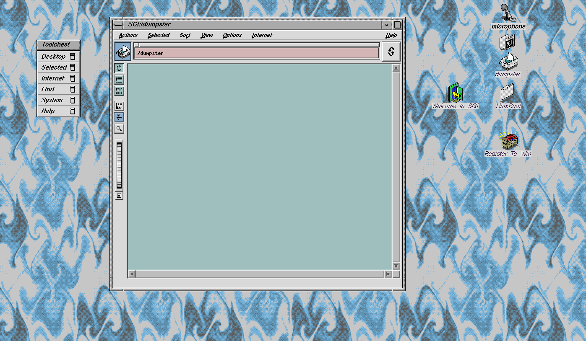

# SGI Octane recovery

Bringing a 1999 SGI Octane back to life from a MacBook, with no monitor, no keyboard and no passwords, then finding out what it was used for.

## The story

About ten years ago I bought a second-hand SGI Octane (R12000, 300 MHz, 128 MB RAM, IRIX 6.5). It never booted properly and I couldn't log in, so it sat on a shelf. In October 2026 I tried again with Claude, driving everything from a MacBook Air:

1. **Serial console.** A USB serial adapter plus a null-modem adapter gave a 9600-baud console to the boot ROM (PROM). A small Python bridge made it scriptable.
2. **Memory fault.** Endless `correctable hard memory error` messages traced back to a physically damaged DIMM. Pulling it fixed the boot.
3. **Netboot.** With no passwords, the way in was SGI's own Installation Tools, booted over Ethernet from the Mac. macOS's `bootpd` received the Octane's BOOTP requests but never answered, and macOS's `tftpd` sends from ports above 32767, which the SGI PROM ignores. Two tiny Python servers replaced both.
4. **Recovery.** From the installer's root shell, both disks were streamed to the Mac as `cpio` archives over `rsh`, received by a minimal rsh endpoint on the Mac. The archive entry counts match the Octane's own counts.
5. **Back to 2004.** With root access restored (and backups of every changed file), IRIX's own desktop session (4Dwm, Toolchest, file manager) now draws into an Xephyr window on the Mac over Ethernet.

**What it turned out to be:** `donder`, a protein-modeling workstation at Bayer's research site, most likely Berkeley, used from 1999 to 2004 for homology modeling and PEGylation of therapeutic proteins such as Factor VIII, bikunin and interleukins. Full findings are in [REPORT.md](REPORT.md).

## Repository layout

| Path | What it is |
| --- | --- |
| [`REPORT.md`](REPORT.md) | What was on the machine and what it was used for |
| `mac/octane_console.py` | Serial bridge: console output to `octane.log`, keystrokes from the `octane.in` FIFO |
| `mac/catch-menu.sh` | Presses Esc at power-on to stop at the PROM System Maintenance Menu |
| `mac/setup-mac.sh`, `mac/teardown-mac.sh` | Stage boot files in `/private/tftpboot` and turn macOS's boot services on or off |
| `mac/bootp_server.py`, `mac/start-bootp.sh` | BOOTP responder that answers only the Octane |
| `mac/tftp_server.py` | Read-only TFTP server that sends from ports below 32768, as the SGI PROM requires |
| `mac/diag-bootp.sh` | Packet capture plus verbose `bootpd`, used to diagnose the netboot |
| `mac/rsh_sink.py` | Receive-only rsh endpoint that writes the incoming stream to a file |
| `mac/rsh_run.py` | Runs one command on the Octane over rsh (macOS no longer ships `rsh`) |
| `mac/start-octane-desktop.sh` | One-step start of the IRIX desktop in a Mac window |
| `irix/mac-desktop` | The matching script on the Octane (`/usr/local/bin/mac-desktop`) |
| `docs/story-de.md` | Short write-up in German |

The recovered disk contents are deliberately not in this repository (see `.gitignore`).

## Using the desktop

Needs only the Ethernet link (Mac `10.10.10.1/8` on the USB adapter, Octane `10.10.10.203`) and [XQuartz](https://www.xquartz.org).

1. Power on the Octane and wait a few minutes for IRIX to boot.
2. Run `mac/start-octane-desktop.sh`.

It opens a 1280×800 Xephyr window called "SGI Octane" (only the Octane may draw in it) and starts IRIX's desktop session there. Close the window to end the session. A short press of the front power button shuts the Octane down cleanly.

## Netbooting the Installation Tools

1. Download *IRIX 6.5 Installation Tools* and copy `dist/sa` and `dist/miniroot/unix.IP30` into `mac/tftp/`.
2. Give the Mac's Ethernet adapter `10.10.10.1/8`. In the PROM Command Monitor: `setenv netaddr 10.10.10.203`.
3. Stop macOS's own services (`sudo launchctl bootout system /System/Library/LaunchDaemons/bootps.plist` and the same for `tftp.plist`), then run `python3 -I mac/bootp_server.py` and `python3 -I mac/tftp_server.py`. No root is needed for these two.
4. At the PROM: `boot -f bootp()sa(sash64)`, then at the `sash:` prompt `setenv tapedevice bootp()10.10.10.1:/sa` and `install`.

The installer copies its miniroot into the disk's swap partition, mounts the disks under `/root`, and its admin menu offers a root shell (`admin` → `sh`).

## Gotchas worth knowing

- The SGI PROM's TFTP client ignores packets from source ports above 32767.
- When the Octane starts a netboot it resets its NIC, so the Mac's link drops for a moment and the first reply can fail with "Network is unreachable". The servers here retry.
- macOS lets a normal user bind ports below 1024, but only on `0.0.0.0`.
- The rsh client sends its stderr port and waits for the server to connect back before sending the rest of the handshake.
- IRIX's serial console has a small line buffer: long command lines get mangled, so send short ones.
- This machine's `/etc/nsswitch.conf` looked up hosts only via DNS and NIS, so with no DNS server it couldn't resolve its own name. Adding `files` first fixed it.
- Current XQuartz drops `-query`, so XDMCP doesn't work. Xephyr (bundled with XQuartz) run with `-noreset` does the job.

## A word of caution

The remote-start setup uses classic `rsh` trust between the Mac and the Octane, a 1990s mechanism with no encryption. Run it only over a direct, private cable, never on a shared network.

## Credits

Recovered by [@MateSteinforth](https://github.com/MateSteinforth) with Claude (Anthropic). The previous owner gave written permission to recover the data.
