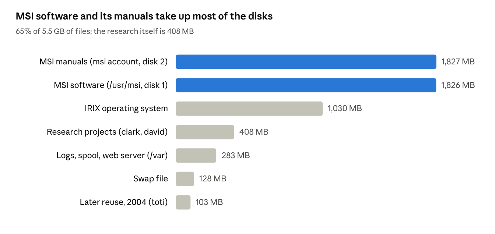

# SGI Octane: what this machine was used for

Report on the contents of a second-hand SGI Octane recovered in October 2026. Written from two complete disk archives, plus a few system files, scripts and Insight II session logs. The protein model files themselves were not opened.

## Summary

This Octane was **donder**, a protein-modeling workstation at Bayer's research site, most likely Berkeley, California, used from 1999 to May 2004. Bayer is confirmed by the MSI licence file; the Berkeley site is inferred.

- **The science:** two scientists built homology models and complexes of therapeutic proteins with MSI's Insight II and MODELLER. Targets include clotting Factors VII and VIII (with a B-domain-deleted form), Kunitz-type inhibitors such as aprotinin and bikunin, and the cytokines IL-2, IL-4 and IL-9 with their receptors. From 2002 much of the work was about **PEGylation**: choosing sites to attach PEG chains so a protein drug lasts longer.
- **The setup:** about 1.8 GB of MSI software (Insight II 98.0 to 2000.3, Cerius² and Felix documentation), licensed to "BAYER WORLDWIDE" until 29 Nov 2004, and scheduled backups to a Bayer server.
- **Afterwards:** in late 2004 it was renamed `octane`, then `SGI`, and reused for web browsing and remote desktop. The last activity is from March 2005.

## What's on the disks

The actual research output is small: about 400 MB of Insight II sessions, protein structures and model files. Most of the disks hold the software that produced it and its manuals.

## Organisation and network

| Clue | Where it was found | What it suggests |
| --- | --- | --- |
| Hostname `donder`, domain `research.brkl.bayer.com` | Mail headers in `/MAIL.SAVED`, `/etc/resolv.conf` | Research division of Bayer; "brkl" most likely Berkeley, California |
| Times stamped `-0700 (PDT)` | Mail headers, 2003–2004 | US Pacific time zone |
| Licence holder "BAYER WORLDWIDE", issued for host `donder` | MSI licence file | Licence bound to this machine |
| Old corporate address and DNS servers (commented out) | `/etc/hosts`, `/etc/resolv.conf` | Original corporate network |
| Later names `octane`, then `SGI`, on a small private network | `/etc/hosts`, `/etc/sys_id` | Second life after leaving Bayer |
| `.desktop-IRIS`, `.desktop-donder`, `.desktop-octane`, `.desktop-SGI` | Root's home directory | One desktop profile per hostname the machine has had |

## Installed software

| Package (folder) | Size | Newest file | What it is |
| --- | --- | --- | --- |
| `/usr/msi/980` | 899 MB | 2000-06 | MSI release 98.0: Insight II and related modules |
| `/usr/msi/I2000.1` | 473 MB | 2002-07 | Insight II 2000.1 |
| `/usr/msi/I2000` | 236 MB | 2002-05 | Insight II 2000 |
| `/usr/msi/msi_docs` | 121 MB | 1999-05 | MSI manuals |
| `/usr/msi/License_Pack` | 73 MB | 2004-05 | Licence manager; Insight II and Biopolymer licensed until 29 Nov 2004 |
| `/usr/msi/2000.3L` | 24 MB | 2004-01 | Later 2000.3 update |
| `msi` user's `cd-set/docu` (disk 2) | 1.8 GB | 2002-05 | Full HTML documentation: Cerius² 4.6, Felix 2002, Insight II |

- **IRIX 6.5**, first installed January 1999; most system folders updated in February 2004 (an IRIX 6.5.x overlay).
- **Graphics and web:** SGI demos, Netscape Communicator with Cosmo Player and Shockwave plugins, Netscape web server folders, Apache.
- **Modeling file types:** Insight II `.psv` sessions (about 280 MB), PDB structures and MODELLER outputs (`*.B9999000n.pdb`, `*.BL000n000n.pdb`).

## Users and their work

| Account | Size | Active | What the folders hold |
| --- | --- | --- | --- |
| `clark` | 358 MB | 1999 – May 2004 | Projects `f7`, `f8`, `kunitz`, `timp`, `il2_il4`, `DAPD`, `vip`, `y2r`, `hgf_sf_nk1` |
| `david` | 50 MB | 2001 – Apr 2004 | `il9` (IL-9 models), IL-4 and IL-4 receptor complexes, CDK2, protein kinase A models |
| `msi` | 1.8 GB | 1999 – 2002 | Owner of the MSI software: documentation CD set and tutorial structures |
| `toti` | 103 MB | Oct – Dec 2004 | Firefox 1.0, `rdesktop` source; no modeling work |
| `tws` | < 1 MB | 1999 – 2004 | Administrator: backup scripts and their README |
| `backup`, `guest` | < 1 MB | – | Backup scripts and log; unused default account |

## Research projects in detail

| Folder | Dates | Proteins | What the files show |
| --- | --- | --- | --- |
| `clark/f8` | Feb – May 2004 | Factor VIII, B-domain-deleted Factor VIII, Factor VIII–IX complex | Sessions named `f8f9peg`, `f8f9peg464-509`, `f8_f9cysC`, `f8bddlys`. The March 2004 log highlights residues 484–509 and singles out Tyr487, Leu491, Lys496 and Leu504, consistent with picking sites for PEG attachment |
| `clark/f7` | May 2004 | Factor VII with tissue factor, Factor X, BPTI | Complexes of the clotting initiation machinery |
| `clark/DAPD` | 2000 – 2003 | Glucagon, GLP-1, albumin | PEGylated glucagon variants (`G51PEG20`); the 2002 log shows a PEG chain being built onto glucagon |
| `clark/il2_il4` | 1999 – 2003 | IL-2, IL-4 | MODELLER runs for IL-2 and a 2003 `PEG` session |
| `clark/kunitz` | 1999 – 2003 | BPTI (aprotinin), bikunin, TFPI, kallikrein, trypsin | Homology models of bikunin and its two Kunitz domains, inhibitor–protease complexes |
| `clark/timp` | 2000 – 2001 | TIMP-1 with MMP-1, -3, -13 | Inhibitor–enzyme complexes, one including collagen |
| `clark/vip`, `clark/y2r` | 2003 | VIP, PACAP-type peptides; NPY and PYY | Surface and electrostatics runs |
| `david/il9` | 2001 – 2002 | IL-9, IL-4, IL-4 receptor, IL-2 | Five MODELLER models of IL-9; IL-9 docked to IL-4Rα |
| `david/msi` | 2001 | Protein kinase A, CDK2, trypsin family | Homology- and loop-modeling exercises |

The pattern fits Bayer's biologics work of the time. Bayer later brought a site-specifically PEGylated, B-domain-deleted Factor VIII to market; linking it to these files is an inference, not something the files state.

## Documents, mail and desktops

- **Mail:** every Netscape mail folder on both disks is empty. Root's `MAIL.SAVED` holds 72 messages, 71 of them cron reports from the backup jobs (Oct 2003 – Jan 2004).
- **Web pages and bookmarks:** default SGI home pages and Netscape's 81 default bookmarks; only `clark` added a few (Insight II manuals, NCBI, an internal Bayer bioinformatics server).
- **Documents:** no office documents or PDFs. The only text and image files are scientific: sequence files, helical-wheel plots and renders of protein models.

## System, admin and curiosities

- **Backups:** `dump.sh` and `dump_sys.sh` ran from root's crontab, `xfsdump`ing each disk, gzipping it and copying it to a backup server on the corporate network.
- **Firefox for the wrong computer:** in November 2004 someone downloaded Firefox 1.0 for Intel Solaris, which cannot run on the Octane's MIPS processor.
- **Licence:** Insight II won't start today; its licence expired on 29 Nov 2004, and it needs OpenGL, which a remote X window can't provide.

## Timeline

| When | Event |
| --- | --- |
| Oct 2026 | Recovered: netbooted, both disks copied to a Mac, desktop shown on the Mac |
| Mar 2005 | Last activity |
| Nov 2004 | Hostname set to `SGI`; MSI licence expires |
| Oct – Dec 2004 | Reused as a general machine (`toti`), hostname `octane` |
| May 2004 | Last modeling work (Factor VII and VIII) |
| Feb 2004 | IRIX 6.5.x update |
| Oct 2003 – Jan 2004 | Scheduled backups to a corporate server |
| 2001 – 2002 | Busiest period: about 13,700 files written; Insight II 2000 installed |
| 1999 | Hostname `donder`; MSI 98.0 installed; first projects |
| Jan 1999 | IRIX 6.5 installed |
